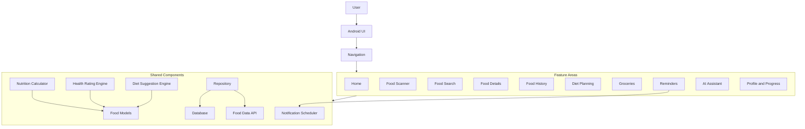

# NUTRIX — AI-Powered Food Intelligence & Personal Nutrition

**Understand your food. Track your nutrition. Build better habits.**

NUTRIX is a native Android application designed to bring food discovery, nutrition information, food tracking, personalized diet planning, hydration, reminders, and AI-assisted nutrition guidance into one mobile experience.

Built with Kotlin and Jetpack Compose, NUTRIX aims to make everyday food information easier to understand and help users make more informed dietary choices through a modern, organized, and accessible interface.

<p align="center">
  <strong>Food Intelligence · Nutrition Tracking · Personalized Planning</strong>
</p>

<p align="center">
  <a href="https://github.com/Dinesh31698/NUTRIX">GitHub Repository</a> ·
  <a href="#features">Features</a> ·
  <a href="#application-screenshots">Screenshots</a> ·
  <a href="#getting-started">Get Started</a>
</p>

---

## Table of Contents

- [Overview](#overview)
- [Features](#features)
- [Application Screenshots](#application-screenshots)
- [Technology Stack](#technology-stack)
- [Architecture](#architecture)
- [Project Structure](#project-structure)
- [Getting Started](#getting-started)
- [Build Commands](#build-commands)
- [Project Documentation](#project-documentation)
- [Privacy and Security](#privacy-and-security)
- [Responsible Nutrition](#responsible-nutrition)
- [Roadmap](#roadmap)
- [Contributing](#contributing)
- [License](#license)

## Overview

Understanding food labels, serving sizes, calories, and nutritional values can be challenging. NUTRIX is designed to make these activities more convenient by bringing food-related information and daily nutrition management into one Android application.

The project combines food discovery, nutrition calculations, food history, dietary planning, hydration tracking, reminders, and AI-assisted guidance in a single experience.

### Project Objectives

- Make food and nutrition information easier to understand.
- Support food discovery and nutritional awareness.
- Help users record food consumption and serving quantities.
- Organize dietary goals and meal-planning workflows.
- Encourage consistent hydration and daily routines.
- Provide a modern Android user experience.
- Build a maintainable foundation for future improvements.

## Features

NUTRIX is organized around the following functional areas. The availability of individual capabilities depends on the current application implementation and its configured services.

### 1. Food Discovery and Scanning

- Food search and selection.
- Packaged-food information lookup through the configured food-data integration.
- Food-scanning workflows for supported inputs.
- Food discovery for Indian dishes and other food items.
- Manual selection when automatic identification is unavailable.

### 2. Nutrition Analysis

- Calorie and nutritional information where available.
- Serving-size and quantity-based nutrition calculations.
- Food health ratings on a 1–5 scale, where supported.
- Nutrition summaries designed for easier interpretation.
- Support for communicating the limitations of estimated food information.

### 3. Food History and Tracking

- Recording food items and serving quantities.
- Reviewing previously recorded entries.
- Organizing food records by date.
- Summarizing available nutrition information.
- Supporting consistent food-tracking habits.

### 4. Personalized Diet Planning

Designed around common nutrition goals:

- Healthy weight gain.
- Weight loss.
- Muscle gain.
- Weight maintenance.
- Balanced nutrition.

The broader goal is to make dietary planning more convenient through organized meal information and user-selected preferences.

### 5. Hydration Tracking

- Recording daily water intake.
- Tracking progress toward a hydration target.
- Supporting more consistent hydration habits.

### 6. Smart Reminders

- Meal and hydration reminder workflows.
- Reminder preferences where supported.
- Android notification integration subject to permissions and system restrictions.

### 7. AI Nutrition Assistant

- Conversational assistance for food-related questions.
- Help understanding nutritional information.
- General food-choice and meal-planning guidance.
- Potential integration with AI services, depending on the configured implementation.

AI-generated information may be incomplete or inaccurate and should be interpreted appropriately.

### 8. Grocery Management

- A dedicated grocery-related feature area.
- Support for organizing food-shopping needs as the functionality develops.

### 9. Personalization and Localization

- A dark-themed interface.
- Reusable design components and shared theming.
- English, Telugu, and Hindi string resources.
- Opportunities for further accessibility and personalization improvements.

## Application Screenshots

Screenshots are maintained in the repository's `screenshots/` directory.

Add your actual screenshot filenames to the gallery below. GitHub renders images using relative paths, so screenshots committed to the repository can appear directly on this page.

<!-- Replace the example filenames below with the actual files in screenshots/. -->

| Home Screen | Food Scanner |
|---|---|
|  |  |

| Food Details | Food History |
|---|---|
|  |  |

| Diet Planning | AI Assistant |
|---|---|
|  |  |

> **Screenshot note:** The filenames above are examples. Replace them with the exact filenames inside your `screenshots/` folder. Remove any gallery entries for images you do not have.

## Technology Stack

| Technology | Purpose |
|---|---|
| Kotlin | Primary application language |
| Android SDK | Native Android platform |
| Jetpack Compose | Declarative UI framework |
| Gradle | Build automation |
| Kotlin DSL | Build configuration |
| AndroidX | Android application support libraries |
| Room | Local database components, as configured |
| Kotlin Coroutines / Flow | Asynchronous operations, where used |
| Open Food Facts API | Packaged-food information integration |
| Android Notifications | Reminder functionality |
| JUnit | Unit testing |

Dependency versions and the exact implementation are defined in the project's Gradle configuration and version catalog.

## Architecture

NUTRIX uses a feature-oriented Kotlin package structure with shared components for data, design, nutrition calculations, networking, and notifications.



*This is a high-level conceptual overview based on the project's source organization, not a complete runtime dependency graph.*

### Architectural Components

- **Feature screens:** Present the main user workflows.
- **Design system:** Provides reusable visual components, colors, and themes.
- **Food models:** Represent food and nutrition-related data.
- **Nutrition calculator:** Supports nutrition calculations.
- **Health rating engine:** Supports food rating logic.
- **Diet suggestion engine:** Supports dietary suggestions.
- **Repository:** Coordinates access to application data.
- **Database components:** Provide local persistence through the configured database layer.
- **Network integration:** Retrieves supported external food information.
- **Notification components:** Support reminder scheduling.

See [`docs/ARCHITECTURE.md`](docs/ARCHITECTURE.md) for further details.

## Project Structure

```text
NUTRIX/
├── app/
│   ├── src/
│   │   ├── main/
│   │   │   ├── java/com/nutrix/app/
│   │   │   │   ├── core/
│   │   │   │   │   ├── database/
│   │   │   │   │   ├── designsystem/
│   │   │   │   │   ├── engine/
│   │   │   │   │   ├── model/
│   │   │   │   │   ├── network/
│   │   │   │   │   └── notifications/
│   │   │   │   ├── data/
│   │   │   │   ├── feature/
│   │   │   │   └── navigation/
│   │   │   ├── res/
│   │   │   └── AndroidManifest.xml
│   │   └── test/
│   └── build.gradle.kts
├── docs/
│   ├── ARCHITECTURE.md
│   ├── PROJECT_STRUCTURE.md
│   └── PRIVACY_AND_SECURITY.md
├── screenshots/
├── gradle/
├── CONTRIBUTING.md
├── ROADMAP.md
├── README.md
├── build.gradle.kts
├── gradle.properties
├── gradlew
├── gradlew.bat
└── settings.gradle.kts
```

This is a representative overview. Some files and directories may differ as the project evolves.

## Getting Started

### Prerequisites

- Android Studio.
- A JDK compatible with the project's Gradle configuration.
- Required Android SDK components.
- An Android emulator or compatible Android device.
- Git.

### 1. Clone the Repository

```bash
git clone https://github.com/Dinesh31698/NUTRIX.git
cd NUTRIX
```

### 2. Open in Android Studio

1. Launch Android Studio.
2. Select **Open**.
3. Choose the cloned `NUTRIX` directory.
4. Allow Gradle synchronization to complete.
5. Install any missing SDK components if prompted.

### 3. Run the Application

1. Start an emulator or connect a compatible Android device.
2. Select the application run configuration.
3. Click **Run** in Android Studio.

Network-dependent features may require internet connectivity and appropriate service configuration.

## Build Commands

Run commands from the project root.

### Windows PowerShell

Build a debug APK:

```powershell
.\gradlew.bat assembleDebug
```

Run unit tests:

```powershell
.\gradlew.bat testDebugUnitTest
```

### macOS or Linux

Build a debug APK:

```bash
./gradlew assembleDebug
```

Run unit tests:

```bash
./gradlew testDebugUnitTest
```

The debug APK is normally generated at:

```text
app/build/outputs/apk/debug/app-debug.apk
```

Build outputs are generated locally and generally should not be committed to the source repository.

## Project Documentation

| Document | Description |
|---|---|
| [Application Architecture](docs/ARCHITECTURE.md) | Components, responsibilities, and data flow |
| [Project Structure](docs/PROJECT_STRUCTURE.md) | Repository organization |
| [Privacy and Security](docs/PRIVACY_AND_SECURITY.md) | Data handling and security principles |
| [Contribution Guidelines](CONTRIBUTING.md) | Contribution workflow |
| [Product Roadmap](ROADMAP.md) | Potential future development priorities |

Keep these documents aligned with the actual source code and implemented functionality.

## Privacy and Security

NUTRIX should follow privacy-conscious development practices:

- Never commit API keys, passwords, tokens, or signing credentials.
- Exclude local machine configuration from version control.
- Request only permissions needed by enabled features.
- Minimize data sent to external services.
- Document relevant data processing and retention behavior.
- Handle service failures without exposing secrets.
- Avoid claiming fully offline operation when a feature depends on a network service.

See [`docs/PRIVACY_AND_SECURITY.md`](docs/PRIVACY_AND_SECURITY.md).

## Responsible Nutrition

NUTRIX is intended to support food awareness and general nutrition education. Nutrition estimates and food ratings may vary with ingredients, serving sizes, preparation methods, and available data.

The application should not be treated as a medical diagnostic tool. Users with medical conditions, allergies, or specialized dietary requirements should consult a qualified healthcare professional.

## Roadmap

Potential future improvements include:

- Expanded packaged-food and regional-food coverage.
- Better food identification and nutrition estimates.
- More transparent health-rating explanations.
- Improved food-history summaries and analytics.
- More flexible weekly meal planning.
- Enhanced hydration and reminder customization.
- More capable AI-assisted food guidance.
- Expanded localization and accessibility.
- Improved offline data access.
- Continued security and maintainability improvements.

See [`ROADMAP.md`](ROADMAP.md) for additional details.

## Contributing

Suggestions, documentation improvements, and code contributions are welcome.

1. Review the project documentation.
2. Create a feature or fix branch.
3. Make focused changes.
4. Review changes for quality and accidental secrets.
5. Commit with a descriptive message.
6. Submit a pull request with a clear explanation.

See [`CONTRIBUTING.md`](CONTRIBUTING.md).

## License

No open-source license has been specified in this repository's documentation. Until a license is added, the default copyright rules apply. Please do not assume the code is available for unrestricted reuse or redistribution.

## Acknowledgements

NUTRIX is built with the Android development ecosystem and may use third-party libraries and food-data services as configured in the project. The applicable licenses and terms of those services remain in effect.

---

<p align="center">
  <strong>NUTRIX — Making everyday nutrition information easier to understand.</strong>
</p>

<p align="center">
  <a href="https://github.com/Dinesh31698/NUTRIX">Explore the Repository</a>
</p>
