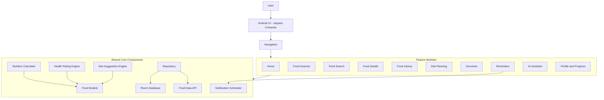

# NUTRIX — Food Intelligence & Personal Nutrition

**Understand your food. Track your nutrition. Build better habits.**

NUTRIX is an Android nutrition companion built with Kotlin and Jetpack Compose. It brings food discovery, nutritional insights, food tracking, diet planning, hydration, reminders, and AI-assisted guidance together in one mobile application.

The project aims to make everyday nutrition information easier to understand and help users make more informed food choices through a modern mobile experience.

**Repository:** [Dinesh31698/NUTRIX](https://github.com/Dinesh31698/NUTRIX)

---

## Table of Contents

- [Overview](#overview)
- [Key Features](#key-features)
- [Technology Stack](#technology-stack)
- [Application Architecture](#application-architecture)
- [Project Structure](#project-structure)
- [Getting Started](#getting-started)
- [Build Commands](#build-commands)
- [Documentation](#documentation)
- [Privacy and Security](#privacy-and-security)
- [Responsible Nutrition](#responsible-nutrition)
- [Roadmap](#roadmap)
- [Contributing](#contributing)
- [License](#license)

## Overview

Choosing nutritious foods can be difficult when food labels, serving sizes, and nutritional information are scattered across different sources.

NUTRIX is designed to bring these activities into one place. Users can explore food information, review nutrition estimates, record food consumption, organize dietary goals, track hydration, and access nutrition-oriented assistance.

The project combines native Android development with a modular application structure intended to support maintainability and future expansion.

### Project Goals

- Make food and nutrition information more accessible.
- Help users understand serving sizes and nutritional values.
- Support consistent food logging and habit tracking.
- Organize dietary goals and meal-planning workflows.
- Provide a clear, modern, and accessible user experience.
- Treat personal information and nutrition data responsibly.

## Key Features

The following sections describe the application's feature areas. Feature availability and behavior depend on the current implementation.

### Food Discovery and Scanning

- Food search and selection workflows.
- Support for packaged-food lookup through available food-data services.
- Food scanning functionality for supported inputs.
- Exploration of Indian foods and dishes.
- Manual food selection when automatic identification is unavailable.

### Nutrition Intelligence

- Calorie and nutritional information where available.
- Serving-size and quantity-based calculations.
- Food health ratings on a 1–5 scale, where supported.
- Nutrition summaries designed to make food information easier to understand.
- Support for distinguishing verified product information from estimates.

### Food History and Tracking

- Recording food items and serving quantities.
- Reviewing previously recorded food entries.
- Organizing food consumption by date.
- Summarizing available nutritional information.
- Supporting more consistent food-tracking habits.

### Personalized Diet Planning

Designed around common nutrition goals:

- Healthy weight gain.
- Weight loss.
- Muscle gain.
- Weight maintenance.
- Balanced nutrition.

Potential planning capabilities include meal organization, dietary preferences, and weekly planning workflows, depending on the implemented functionality.

### Hydration Tracking

- Recording water intake.
- Tracking progress toward a daily hydration target.
- Supporting more consistent hydration habits.

### Smart Reminders

- Meal and hydration reminder workflows.
- User-configurable reminder preferences where available.
- Android notification integration, subject to permissions and system restrictions.

### AI Nutrition Assistant

- Conversational assistance for food-related questions.
- Help understanding nutritional information.
- General food-choice and meal-planning guidance.
- Potential integration with AI services, depending on the configured implementation.

AI-generated information may be incomplete or inaccurate and should be interpreted appropriately.

### Grocery Management

- A dedicated grocery-related feature area.
- Potential support for organizing food-shopping needs and meal-planning ingredients.

### Personalization and Localization

- A dark-themed visual design.
- Shared design components and reusable UI elements.
- English, Telugu, and Hindi string resources.
- Opportunities to extend accessibility, localization, and personalization.

## Technology Stack

| Technology | Purpose |
|---|---|
| Kotlin | Primary application programming language |
| Android SDK | Native Android platform |
| Jetpack Compose | Declarative UI framework |
| Gradle | Build automation |
| Kotlin DSL | Build configuration |
| AndroidX | Android application support libraries |
| Room | Local database components, as configured |
| Kotlin Coroutines / Flow | Asynchronous operations, where used |
| Open Food Facts integration | Packaged-food data access through the configured API |
| Android Notifications | Reminder delivery |
| JUnit | Unit testing |

The exact dependencies and versions are defined by the project's Gradle configuration and version catalog.

## Application Architecture

NUTRIX uses a feature-oriented Kotlin package structure with shared components for data, design, networking, calculations, and application behavior.



*The diagram illustrates the major components represented in the project structure. It is a high-level overview rather than a complete runtime dependency graph.*

### Architectural Responsibilities

- **Feature screens:** Present food, nutrition, history, planning, and related workflows.
- **Design system:** Provides reusable visual components, colors, and theming.
- **Food models:** Represent food and nutrition-related data.
- **Nutrition calculator:** Handles nutrition calculations.
- **Health rating engine:** Supports food rating logic.
- **Diet suggestion engine:** Supports diet-related suggestions.
- **Repository:** Coordinates access to application data.
- **Database components:** Provide local persistence through the configured database layer.
- **Network integration:** Retrieves supported external food information.
- **Notification components:** Support scheduled reminders.

See [`docs/ARCHITECTURE.md`](docs/ARCHITECTURE.md) for additional architectural documentation.

## Project Structure

```text
NUTRIX/
├── app/
│   ├── src/
│   │   ├── main/
│   │   │   ├── java/com/nutrix/app/
│   │   │   │   ├── core/
│   │   │   │   │   ├── database/
│   │   │   │   │   ├── designsystem/
│   │   │   │   │   ├── engine/
│   │   │   │   │   ├── model/
│   │   │   │   │   ├── network/
│   │   │   │   │   └── notifications/
│   │   │   │   ├── data/
│   │   │   │   │   ├── repository/
│   │   │   │   │   └── seed/
│   │   │   │   ├── feature/
│   │   │   │   └── navigation/
│   │   │   ├── res/
│   │   │   └── AndroidManifest.xml
│   │   └── test/
│   └── build.gradle.kts
├── docs/
│   ├── ARCHITECTURE.md
│   ├── PROJECT_STRUCTURE.md
│   └── PRIVACY_AND_SECURITY.md
├── gradle/
│   ├── libs.versions.toml
│   └── wrapper/
├── CONTRIBUTING.md
├── ROADMAP.md
├── README.md
├── build.gradle.kts
├── gradle.properties
├── gradlew
├── gradlew.bat
└── settings.gradle.kts
```

Generated build files, local configuration, and ignored files may not appear in this listing.

## Getting Started

### Prerequisites

- Android Studio.
- A JDK version compatible with the project's Gradle configuration.
- Android SDK components required by the project.
- An Android emulator or physical Android device.
- Git.

### 1. Clone the Repository

```bash
git clone https://github.com/Dinesh31698/NUTRIX.git
cd NUTRIX
```

### 2. Open in Android Studio

1. Open Android Studio.
2. Select **Open**.
3. Choose the cloned `NUTRIX` directory.
4. Allow Gradle synchronization to complete.
5. Install any missing SDK components if prompted.

### 3. Run the Application

1. Start an Android emulator or connect a compatible Android device.
2. Select the app run configuration in Android Studio.
3. Click **Run** to install and launch the application.

Some features may depend on internet connectivity, Android permissions, or external service configuration.

## Build Commands

Run these commands from the repository root.

### Windows PowerShell

Build a debug APK:

```powershell
.\gradlew.bat assembleDebug
```

Run unit tests:

```powershell
.\gradlew.bat testDebugUnitTest
```

### macOS or Linux

Build a debug APK:

```bash
./gradlew assembleDebug
```

Run unit tests:

```bash
./gradlew testDebugUnitTest
```

The debug APK is normally generated at:

```text
app/build/outputs/apk/debug/app-debug.apk
```

Build outputs are generated locally and should not be committed unless there is a specific reason to distribute them through Git.

## Documentation

| Document | Description |
|---|---|
| [Architecture](docs/ARCHITECTURE.md) | Application components and data flow |
| [Project Structure](docs/PROJECT_STRUCTURE.md) | Repository organization and file responsibilities |
| [Privacy and Security](docs/PRIVACY_AND_SECURITY.md) | Data-handling principles and security practices |
| [Contributing](CONTRIBUTING.md) | Contribution workflow and coding guidance |
| [Roadmap](ROADMAP.md) | Potential future improvements |

These documents describe the project design and intended practices. They should be kept aligned with the actual implementation.

## Privacy and Security

NUTRIX should follow privacy-conscious development practices:

- Keep API keys, passwords, tokens, and signing credentials out of public source control.
- Exclude local machine configuration from Git.
- Request only the Android permissions required by enabled features.
- Minimize data sent to external services.
- Explain relevant data processing and retention behavior.
- Handle network failures and unavailable services safely.
- Provide appropriate controls for personal records as the implementation evolves.

See [`docs/PRIVACY_AND_SECURITY.md`](docs/PRIVACY_AND_SECURITY.md).

## Responsible Nutrition

NUTRIX is intended to support food awareness and general nutrition education. Nutrition estimates and food ratings may vary according to ingredient data, serving size, preparation methods, and data availability.

The application should not be treated as a medical diagnostic tool. Users with medical conditions, allergies, or specialized dietary requirements should consult a qualified healthcare professional.

## Roadmap

Potential future areas of development include:

- Improved food recognition and packaged-product lookup.
- Expanded Indian food and regional dish coverage.
- More transparent nutrition-rating explanations.
- Better food-history summaries and analytics.
- More flexible weekly diet planning.
- Enhanced hydration and reminder customization.
- Improved AI-assisted food guidance.
- Expanded localization and accessibility.
- Better offline access and data management.
- Continued improvements to privacy, maintainability, and documentation.

See [`ROADMAP.md`](ROADMAP.md) for the broader development direction.

## Contributing

Suggestions, documentation improvements, and code contributions are welcome.

1. Review the project documentation.
2. Create a feature or fix branch.
3. Make focused changes.
4. Review your changes and remove sensitive information.
5. Commit with a descriptive message.
6. Submit a pull request with a clear explanation.

See [`CONTRIBUTING.md`](CONTRIBUTING.md) for details.

## License

No open-source license has been specified in this repository's documentation. Until a license is added, the default copyright rules apply. Please do not assume that the code is available for unrestricted reuse or redistribution.

## Acknowledgements

NUTRIX is built with the Android development ecosystem and may use third-party libraries and food-data services as configured in the project. Their respective licenses and terms apply.

---

**NUTRIX — Making everyday nutrition information easier to understand.**

[View Repository](https://github.com/Dinesh31698/NUTRIX)
