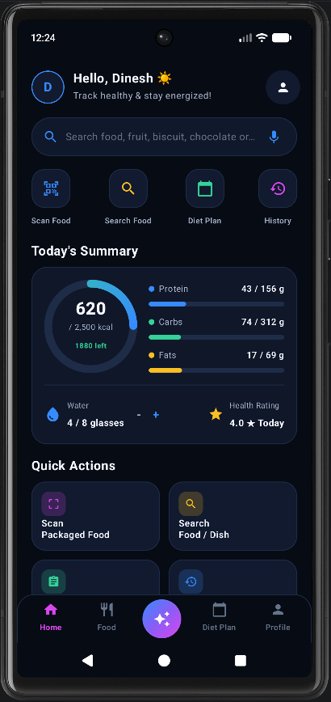
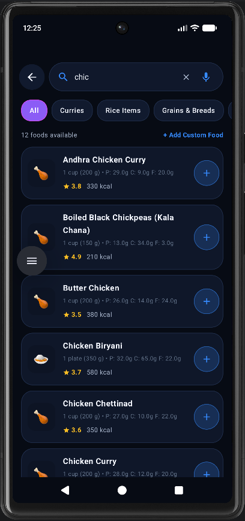
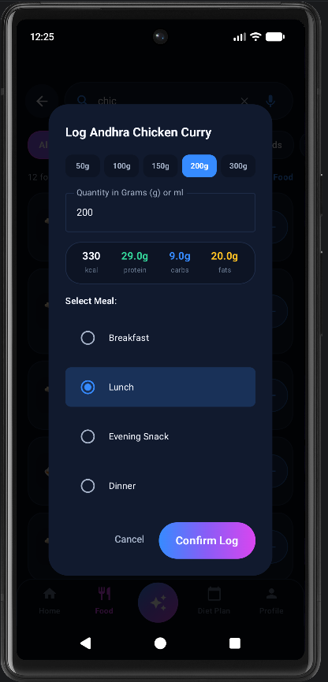
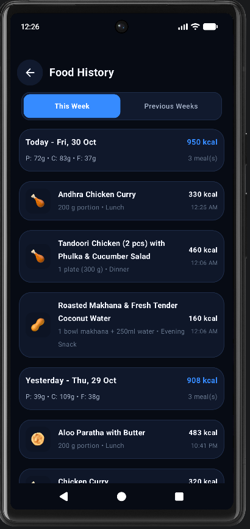
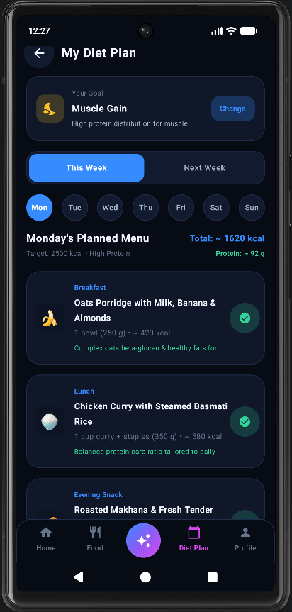
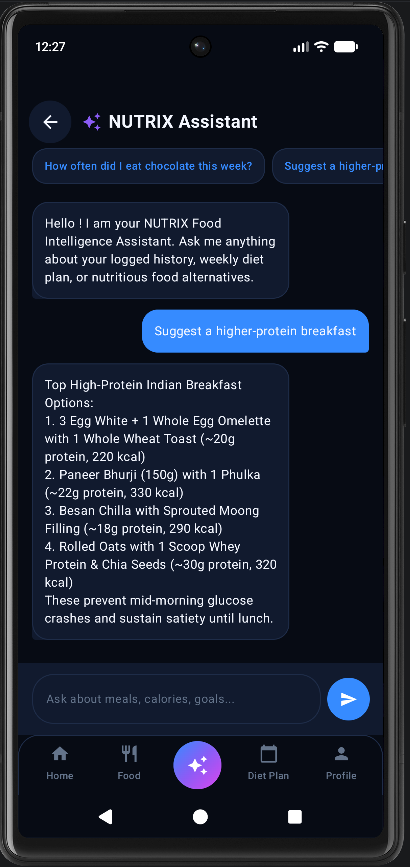
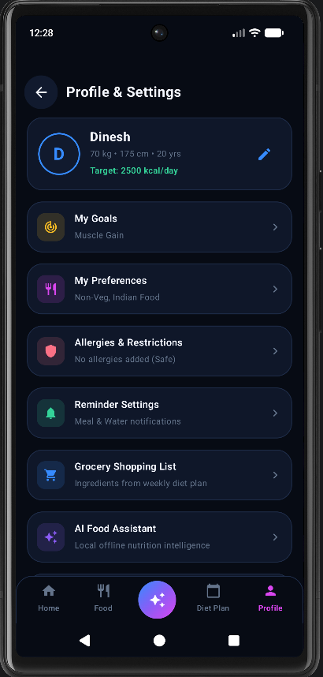
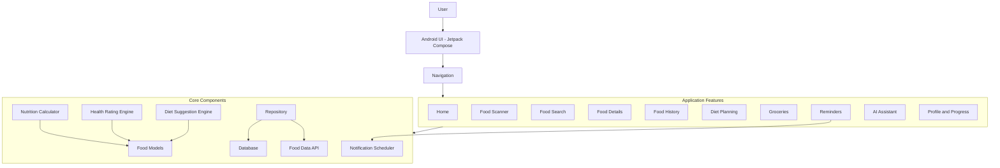

# NUTRIX — AI-Powered Food Intelligence & Personal Nutrition

<p align="center">
  <strong>Understand Your Food. Track Your Nutrition. Build Better Habits.</strong>
</p>

<p align="center">
  A modern Android nutrition companion designed to make food discovery, nutritional awareness, and personalized dietary management easier.
</p>

<p align="center">
  
</p>

<p align="center">
  <a href="https://github.com/Dinesh31698/NUTRIX">GitHub Repository</a> •
  <a href="#features">Features</a> •
  <a href="#application-screenshots">Screenshots</a> •
  <a href="#getting-started">Getting Started</a>
</p>

---

## About NUTRIX

NUTRIX is an Android application built to bring food intelligence and everyday nutrition management into one convenient platform.

Understanding food labels, calories, serving quantities, and nutritional values can be challenging. NUTRIX aims to simplify this experience by combining food discovery, nutrition analysis, food history, personalized diet planning, hydration tracking, reminders, and AI-assisted guidance.

Developed using Kotlin and Jetpack Compose, the application focuses on a modern mobile experience with a structured architecture and reusable components.

### Vision

To make everyday nutrition information more accessible, understandable, and actionable.

### Objectives

- Simplify food discovery and nutritional awareness.
- Help users understand calories and serving quantities.
- Support consistent food tracking.
- Organize personalized dietary goals.
- Encourage healthier everyday routines.
- Provide convenient nutrition-related assistance.
- Build a maintainable and extensible Android application.

---

## Features

### 1. Food Discovery & Scanning

- Food search and selection.
- Packaged-food information lookup through the configured food-data integration.
- Food-scanning workflows for supported inputs.
- Discovery of Indian foods and dishes.
- Manual food selection when automatic identification is unavailable.

### 2. Nutrition Intelligence

- Calorie information where available.
- Nutrition calculations based on serving quantities.
- Food health ratings on a 1–5 scale, where supported.
- Food-related nutritional summaries.
- Easier interpretation of available nutrition information.

### 3. Food History & Tracking

- Record food consumption.
- Maintain food history.
- Review previously recorded food entries.
- Track serving quantities.
- Organize food records by date.
- Review available nutritional information.

### 4. Personalized Diet Planning

Supports common dietary goals:

- Healthy weight gain.
- Weight loss.
- Muscle gain.
- Weight maintenance.
- Balanced nutrition.

The diet-planning feature area is designed to help organize meal choices around user-selected goals.

### 5. Hydration Tracking

- Record water intake.
- Track daily hydration progress.
- Support consistent hydration habits.

### 6. Smart Reminders

- Meal reminder workflows.
- Hydration reminder workflows.
- Android notification integration.
- Reminder customization where supported.

### 7. AI Nutrition Assistant

- Conversational food-related assistance.
- Help understanding nutritional information.
- General nutrition guidance.
- Food-choice and meal-planning assistance.

AI-generated information may be incomplete or inaccurate and should be interpreted appropriately.

### 8. Grocery Management

- Dedicated grocery feature area.
- Organization of food-shopping needs as functionality develops.

### 9. Personalization & Localization

- Modern dark-themed interface.
- Reusable design components.
- Shared color and theme system.
- English, Telugu, and Hindi string resources.
- Scope for future accessibility improvements.

---

## Application Screenshots

Explore the NUTRIX Android application through its main screens.

### Home Screen

<p align="center">
  
</p>

### Food Search & Discovery

<p align="center">
  
</p>

### Food Quantity & Nutrition

<p align="center">
  
</p>

### Food History

<p align="center">
  
</p>

### Personalized Diet Planning

<p align="center">
  
</p>

### AI Nutrition Assistant

<p align="center">
  
</p>

### Settings & Personalization

<p align="center">
  
</p>

---

## Technology Stack

| Technology | Purpose |
|---|---|
| Kotlin | Primary programming language |
| Android SDK | Native Android development |
| Jetpack Compose | Modern declarative UI |
| Gradle | Build automation |
| Kotlin DSL | Build configuration |
| AndroidX | Android application libraries |
| Room | Local database components |
| Kotlin Coroutines / Flow | Asynchronous operations where used |
| Open Food Facts API | Packaged-food information integration |
| Android Notifications | Reminder functionality |
| JUnit | Unit testing |

Dependency versions and configurations are maintained in the project's Gradle files and version catalog.

---

## Application Architecture

NUTRIX follows a feature-oriented application structure with shared components for data management, design, nutrition calculations, networking, and notifications.



### Core Responsibilities

- **Feature Layer:** Contains individual application screens and workflows.
- **Design System:** Manages reusable UI components, colors, and themes.
- **Data Models:** Represents food and nutrition-related information.
- **Nutrition Calculator:** Performs nutrition calculations.
- **Health Rating Engine:** Supports food rating logic.
- **Diet Suggestion Engine:** Supports dietary suggestions.
- **Repository:** Coordinates application data access.
- **Database:** Provides local persistence through the configured database layer.
- **Network Layer:** Integrates with external food-data services.
- **Notification Layer:** Handles reminder scheduling.

For additional information, see [`docs/ARCHITECTURE.md`](docs/ARCHITECTURE.md).

---

## Project Structure

```text
NUTRIX/
│
├── app/
│   ├── src/
│   │   ├── main/
│   │   │   ├── java/com/nutrix/app/
│   │   │   │   ├── core/
│   │   │   │   │   ├── database/
│   │   │   │   │   ├── designsystem/
│   │   │   │   │   ├── engine/
│   │   │   │   │   ├── model/
│   │   │   │   │   ├── network/
│   │   │   │   │   └── notifications/
│   │   │   │   │
│   │   │   │   ├── data/
│   │   │   │   │   ├── repository/
│   │   │   │   │   └── seed/
│   │   │   │   │
│   │   │   │   ├── feature/
│   │   │   │   │   ├── assistant/
│   │   │   │   │   ├── dietplan/
│   │   │   │   │   ├── fooddetails/
│   │   │   │   │   ├── foodhistory/
│   │   │   │   │   ├── foodsearch/
│   │   │   │   │   ├── grocery/
│   │   │   │   │   ├── home/
│   │   │   │   │   ├── onboarding/
│   │   │   │   │   ├── progress/
│   │   │   │   │   ├── reminders/
│   │   │   │   │   ├── scanner/
│   │   │   │   │   └── scanresult/
│   │   │   │   │
│   │   │   │   └── navigation/
│   │   │   │
│   │   │   ├── res/
│   │   │   └── AndroidManifest.xml
│   │   │
│   │   └── test/
│   │
│   └── build.gradle.kts
│
├── docs/
│   └── ARCHITECTURE.md
│
├── screenshots/
│   ├── AI.png
│   ├── DitePlan.png
│   ├── FoodHistory.png
│   ├── FoodQuantity.png
│   ├── HomeScreen.png
│   ├── SearchFood.png
│   └── Settings.png
│
├── gradle/
│   ├── libs.versions.toml
│   └── wrapper/
│
├── README.md
├── ROADMAP.md
├── .gitignore
├── build.gradle.kts
├── gradle.properties
├── gradlew
├── gradlew.bat
└── settings.gradle.kts
```

This is a representative overview of the repository's organization. Additional files may exist as development progresses.

---

## Getting Started

### Prerequisites

- Android Studio.
- A compatible JDK.
- Android SDK.
- Android emulator or physical Android device.
- Git.

### 1. Clone the Repository

```bash
git clone https://github.com/Dinesh31698/NUTRIX.git
```

### 2. Open the Project

1. Launch Android Studio.
2. Select **Open**.
3. Choose the cloned `NUTRIX` folder.
4. Allow Gradle synchronization to complete.
5. Install any required Android SDK components.

### 3. Run the Application

1. Start an Android emulator or connect an Android device.
2. Select the application run configuration.
3. Click **Run** in Android Studio.

Some features may require internet connectivity, permissions, or external service configuration.

---

## Build Commands

Run these commands from the project root.

### Windows PowerShell

Build the debug APK:

```powershell
.\gradlew.bat assembleDebug
```

Run unit tests:

```powershell
.\gradlew.bat testDebugUnitTest
```

### macOS / Linux

Build the debug APK:

```bash
./gradlew assembleDebug
```

Run unit tests:

```bash
./gradlew testDebugUnitTest
```

The debug APK is normally generated at:

```text
app/build/outputs/apk/debug/app-debug.apk
```

---

## Privacy & Security

NUTRIX aims to follow responsible application development practices:

- Keep API keys, passwords, and private credentials out of source control.
- Exclude local machine configuration from Git.
- Request only permissions required by application features.
- Minimize unnecessary sharing of personal information.
- Handle external service failures safely.
- Document relevant data-processing behavior as the application evolves.

---

## Responsible Nutrition

NUTRIX is intended for general food awareness and nutrition education.

Nutrition information and ratings can vary depending on ingredient data, serving quantities, preparation methods, and information availability.

NUTRIX should not be considered a medical diagnostic tool or a replacement for professional dietary advice. Users with medical conditions, allergies, or specialized nutritional needs should consult qualified healthcare professionals.

---

## Future Roadmap

Potential future improvements include:

- Expanded packaged-food database coverage.
- Improved food recognition workflows.
- More regional Indian food information.
- More transparent health-rating explanations.
- Improved food-history analytics.
- Flexible weekly diet planning.
- Enhanced hydration and reminder customization.
- More capable AI-assisted nutrition guidance.
- Improved offline access.
- Additional localization and accessibility.
- Continued security and maintainability improvements.

See [`ROADMAP.md`](ROADMAP.md) for the development direction.

---

## Contributing

Suggestions, improvements, and contributions are welcome.

1. Review the existing source code and documentation.
2. Create a feature or fix branch.
3. Make focused changes.
4. Review your changes before committing.
5. Submit a pull request with a clear explanation.

---

## License

No open-source license has currently been specified for this repository. Unless a license is added, the default copyright rules apply. Please do not assume unrestricted permission to reuse or redistribute the source code.

---

## Acknowledgements

NUTRIX is built using the Android development ecosystem and may use third-party libraries and food-data services as configured in the application. Their respective licenses and terms apply.

---

<p align="center">
  <strong>NUTRIX</strong>
  <br>
  Making everyday nutrition information easier to understand.
  <br><br>
  <a href="https://github.com/Dinesh31698/NUTRIX">Explore NUTRIX on GitHub</a>
</p>