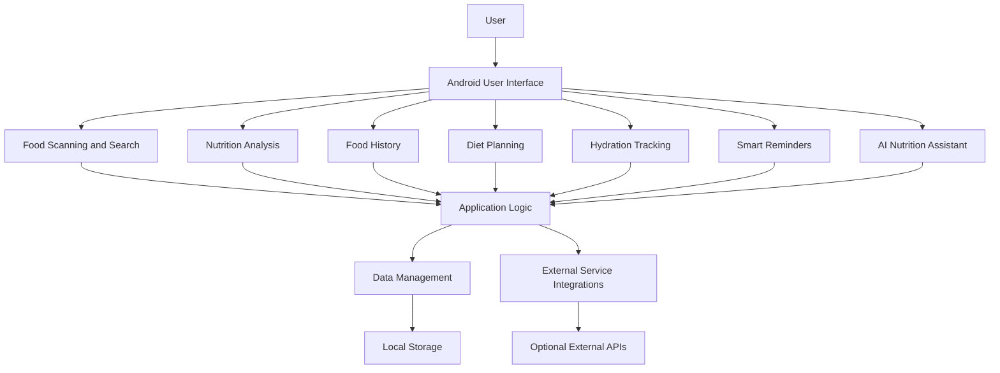
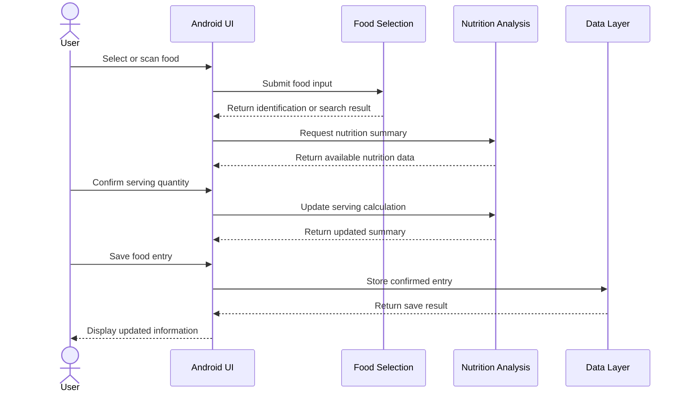

# NUTRIX — Application Architecture

## 1. Introduction

NUTRIX is an Android application focused on food intelligence, nutrition awareness, and personalized dietary management. It aims to bring food scanning, nutrition analysis, food history, diet planning, hydration tracking, reminders, and AI-assisted guidance into a unified mobile experience.

This document describes the application's architectural organization, major functional components, data flow, and potential integration points.

## 2. Architectural Overview

NUTRIX is organized as a native Android project built with Kotlin and Gradle.

The architecture separates the user interface, application logic, data management, and external service integrations into logical responsibilities. The exact implementation of each responsibility depends on the source files and dependencies present in the repository.

### High-Level Architecture



*This is a conceptual architecture diagram. It represents the intended functional organization, not a verified map of existing classes or runtime connections.*

## 3. Core Components

### 3.1 User Interface

The presentation layer provides the screens and interactions through which users access NUTRIX functionality.

Its responsibilities include:

- Displaying food and nutrition information.
- Collecting serving quantities and user preferences.
- Presenting food history and nutrition summaries.
- Supporting diet planning and hydration tracking.
- Providing access to reminders and AI assistance.
- Communicating application state and errors to the user.

### 3.2 Food Scanning and Search

This component is intended to support food discovery through supported scanning and search workflows.

Potential responsibilities include:

- Capturing or receiving food images.
- Processing supported packaged-food identifiers or images.
- Searching for food items and Indian dishes.
- Passing identified food information to the nutrition component.
- Allowing manual selection when automatic recognition is unavailable.

Recognition accuracy depends on the selected recognition method and the available food database.

### 3.3 Nutrition Analysis

The nutrition component organizes food information into understandable summaries.

Its responsibilities may include:

- Calculating nutrition estimates for a selected serving.
- Scaling nutrition values according to quantity.
- Presenting calorie and macronutrient information where available.
- Generating a food health rating using documented criteria.
- Explaining the limitations of estimates and missing data.

Nutrition calculations should use clearly defined units and distinguish verified product-label values from estimates.

### 3.4 Food History

The food history component is intended to organize recorded food consumption over time.

Potential responsibilities include:

- Recording selected food items and serving quantities.
- Associating entries with dates and meal categories.
- Retrieving previously saved records.
- Summarizing available daily nutritional information.
- Supporting historical views and progress summaries.

### 3.5 Personalized Diet Planning

This component is intended to organize dietary guidance around a user's selected goal.

Supported goal categories may include:

- Healthy weight gain.
- Weight loss.
- Muscle gain.
- Weight maintenance.
- Balanced nutrition.

Diet planning should account for user preferences and available nutrition data. Recommendations should remain general wellness guidance rather than medical prescriptions.

### 3.6 Hydration Tracking

The hydration component is intended to record water intake and compare it with a user-configured daily target.

Potential responsibilities include recording water consumption, calculating daily totals, and displaying progress.

### 3.7 Smart Reminders

The reminder component is intended to help users maintain consistent routines.

Potential reminder categories include:

- Meal reminders.
- Hydration reminders.
- User-configured nutrition routines.

Reminder scheduling and notification delivery depend on the Android notification and scheduling mechanisms implemented by the application.

### 3.8 AI Nutrition Assistant

The AI assistant is intended to provide conversational support for food-related questions and general nutrition awareness.

Depending on the selected implementation, it may use a local model or an external API. Any external integration should handle connectivity errors, request failures, usage limits, and credential security.

AI-generated nutrition information should be presented with appropriate uncertainty and should not replace professional medical advice.

## 4. Data Management

The data layer is responsible for storing and retrieving the information required by the application.

Potential data categories include:

- User preferences and nutrition goals.
- Food records and serving quantities.
- Daily calorie and nutrition summaries.
- Hydration records.
- Reminder settings.
- Diet planning information.

Local persistence can support offline access to saved information. Network-dependent recognition, AI assistance, or external food databases may still require connectivity.

The actual storage technology should be documented according to the project's implemented database and persistence libraries.

## 5. Data Flow

A typical food-analysis workflow can be represented as follows:



This sequence illustrates an intended workflow. Actual behavior depends on the application's existing implementation.

## 6. Android Project Organization

The repository follows the standard structure of a Gradle-based Android project.

```text
NUTRIX/
├── app/
│   └── src/
│       └── main/
│           ├── java/ or kotlin/
│           ├── res/
│           └── AndroidManifest.xml
├── gradle/
├── .gitignore
├── build.gradle.kts
├── gradle.properties
├── gradlew
├── gradlew.bat
├── settings.gradle.kts
├── README.md
└── docs/
    └── ARCHITECTURE.md
```

### Root Configuration Files

| File or Directory | Responsibility |
|---|---|
| `app/` | Android application module and source code |
| `gradle/` | Gradle wrapper support files |
| `build.gradle.kts` | Root build configuration |
| `settings.gradle.kts` | Project and module configuration |
| `gradle.properties` | Gradle configuration properties |
| `gradlew` | Unix-like Gradle wrapper script |
| `gradlew.bat` | Windows Gradle wrapper script |
| `.gitignore` | Excludes specified files from Git |
| `docs/` | Project documentation |

The internal organization of the `app` module should be expanded as the actual Kotlin packages, resources, and data components are documented.

## 7. Security and Privacy

NUTRIX should follow these security principles:

- Keep API keys and access tokens out of source control.
- Avoid committing machine-specific configuration files.
- Request only the Android permissions needed for enabled features.
- Handle personal food logs and preferences responsibly.
- Explain when information is sent to external services.
- Handle API errors without exposing secrets or sensitive data.
- Avoid claiming complete offline operation when a feature depends on a network service.

## 8. Reliability and Error Handling

The application should account for common failure conditions, including:

- Unsupported food inputs.
- Missing or incomplete nutrition information.
- Unavailable external services.
- Network interruptions.
- Invalid serving quantities.
- Storage failures.
- Notification permission restrictions.

User-facing messages should explain the problem clearly and provide a practical next action whenever possible.

## 9. Extensibility

The architecture can be extended as NUTRIX evolves.

Potential areas include:

- Broader packaged-food and regional-food coverage.
- Improved food recognition.
- More detailed nutrition analytics.
- Personalized weekly meal planning.
- Additional language resources.
- Expanded offline capabilities.
- Additional AI integrations.

New components should follow the existing project's conventions and minimize unnecessary coupling between the user interface, business logic, and data storage.

## 10. Current Documentation Status

This document describes the intended functional architecture of NUTRIX. It does not independently verify the implementation status of every feature, external service, or data-storage mechanism.

As the codebase evolves, this document should be updated to reflect the actual Kotlin classes, dependencies, persistence layer, and service integrations.

---

**Project:** NUTRIX  
**Platform:** Android  
**Primary Language:** Kotlin  
**Build System:** Gradle with Kotlin DSL  
**Repository:** https://github.com/Dinesh31698/NUTRIX
